<p align="center">
  
</p>

# 🧱 CSE207 · Data Structures (Java)

Lab work and assignments for **CSE207 (Data Structures)**, written in Java. Each lab has the source code and the lab sheet (`.docx`).

| Lab | Topic | Key class |
|---|---|---|
| [Lab01](Lab01/) | Linear search | `LinearSearchAlgorithm` |
| [Lab02](Lab02/) | Binary search | `BinarySearch` |
| [Lab03](Lab03/) | Bubble sort | `BubbleSortingAlgorithm` |
| [Lab04](Lab04/) | Selection sort | `SelectionSortingAlgorithm` |
| [Lab05](Lab05/) | Matrix operations | `MatrixOperations` |
| [Lab06](Lab06/) | Singly linked list | `LinkedList`, `Node` |
| [Lab07](Lab07/) | Stack | `StackOperations` |
| [Lab08](Lab08/) | Queue | `Queue` |
| [Lab09](Lab09/) | Recursion: factorial, Fibonacci, reverse printing | `Calculate` |
| [Lab10](Lab10/) | Binary tree traversal | `TreeTraversal` |

**Assignments:** doubly linked list implementations in [`Assignment/`](Assignment/), [`AnonymousAssignment/`](AnonymousAssignment/) and [`HW/`](HW/).

## Run a lab

Each lab is its own Java package. Compile and run from the repository root:

```bash
javac Lab02/*.java
java Lab02.Main
```
